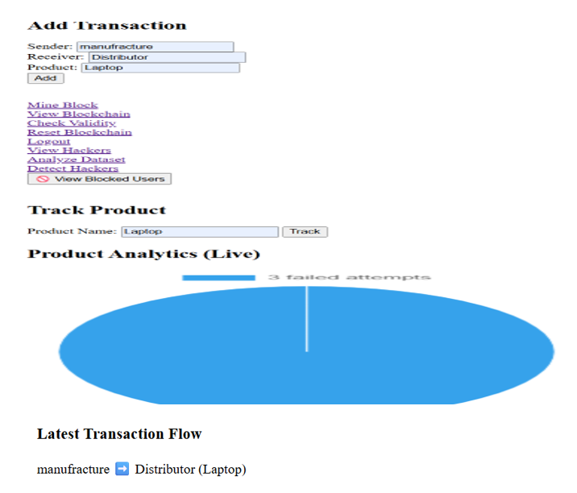

# 🔐 Blockchain-Based Cybersecurity Intrusion Detection System

## 📌 Project Overview

The **Blockchain-Based Cybersecurity Intrusion Detection System** is a Python-based web application designed to identify suspicious login activities and detect potential cyber threats using blockchain technology and cybersecurity dataset analysis.

The system monitors user login activities, identifies suspicious behavior, detects repeated failed login attempts, and records security-related events.

It integrates blockchain technology to maintain transaction records securely and uses an SQLite database to store user information, login attempts, transactions, blocks, and detected hackers.

The application provides a web-based interface developed using Flask to manage blockchain operations and monitor cybersecurity activities.

## 🎯 Project Objectives

- To detect suspicious login activities and potential cyberattacks.
- To identify users with multiple failed login attempts.
- To detect unusual login times and suspicious activities.
- To implement blockchain technology for maintaining transaction records.
- To analyze cybersecurity intrusion datasets.
- To store and manage security information using SQLite.
- To improve monitoring and tracking of cybersecurity threats.

## 🛠️ Technologies Used

| Technology | Purpose |
|---|---|
| Python | Backend programming |
| Flask | Web application development |
| Blockchain | Secure transaction recording |
| SQLite | Database management |
| Pandas | Dataset processing and analysis |
| HTML, CSS, JavaScript | Web interface |
| SHA-256 | Hash generation |
| Proof of Work | Blockchain mining mechanism |

## ✨ Key Features

### 1. User Registration and Login
- Allows users to register and log in.
- Checks user credentials.
- Records successful and unsuccessful login attempts.
  ### Login Page

 ###  Main Dashboard


### 2. Hacker Detection
- Detects repeated failed login attempts.
- Identifies suspicious login activities.
- Blocks users after three failed login attempts.
- Identifies suspicious login activities during unusual hours.
 ###  Hacker Detection


### 3. Blockchain Implementation
- Creates blocks containing transaction information.
- Generates SHA-256 hashes.
- Implements Proof of Work mining.
- Maintains connections between blocks using previous hashes.
- Checks blockchain integrity.
  ###  Blocked Users Dashboard


### 4. Cybersecurity Dataset Analysis
- Loads cybersecurity intrusion data from a CSV file.
- Analyzes login attempts and failed login records.
- Identifies suspicious sessions.
- Stores detected hacker information in the database.

### 5. Database Management
- Uses SQLite for storing application information.
- Maintains user records.
- Stores blockchain transactions and blocks.
- Records login attempts and detected hackers.

### 6. Blockchain Monitoring
- Add transactions.
- Mine new blocks.
- View the blockchain.
- Verify blockchain validity.
- Track products or transactions.
- Detect blockchain tampering.

## 🏗️ Project Architecture

The project consists of the following components:

1. **Frontend:** Provides the user interface.
2. **Flask Backend:** Handles application requests and operations.
3. **Blockchain Module:** Creates blocks, generates hashes and performs mining.
4. **Database Module:** Manages application data using SQLite.
5. **Dataset Analysis Module:** Processes cybersecurity intrusion records.
6. **Detection Module:** Identifies suspicious login activities and potential hackers.

## 📂 Project Structure

```text
Blockchain/
│
├── app.py
│
├── blockchain.py
│
├── database.py
│
├── dataset_analysis.py
│
├── insert_dataset.py
│
├── cybersecurity_intrusion_data.csv
│
├── blockchain.db
│
├── routes/
│   ├── transaction_routes.py
│   ├── block_routes.py
│   └── utility_routes.py
│
├── templates/
│   ├── index.html
│   ├── login.html
│   ├── register.html
│   ├── hackers.html
│   └── blocked_dashboard.html
│
└── README.md
```

## ⚙️ Installation and Execution

### Step 1: Clone the Repository

```bash
git clone YOUR_GITHUB_REPOSITORY_URL
```

### Step 2: Open the Project Folder

```bash
cd Blockchain
```

### Step 3: Install Required Libraries

```bash
pip install flask pandas
```

### Step 4: Initialize the Database

```bash
python -c "from database import init_db; init_db()"
```

### Step 5: Insert Dataset into Database

```bash
python insert_dataset.py
```

### Step 6: Perform Dataset Analysis

```bash
python dataset_analysis.py
```

### Step 7: Run the Application

```bash
python app.py
```

### Step 8: Open the Application

Open your browser and visit:

```text
http://127.0.0.1:5000/
```

## 📊 Dataset Information

**Dataset Name:** Cybersecurity Intrusion Dataset

**File Name:** `cybersecurity_intrusion_data.csv`

The dataset is used to identify suspicious login activities and potential security threats.

Important attributes used in the analysis include:

- Session ID
- Login Attempts
- Failed Logins
- Unusual Time
- Attack Detected
- Browser Type

## 🔒 Blockchain Security

The project implements the following blockchain concepts:

- SHA-256 Hashing
- Proof of Work
- Block Creation
- Previous Block Hash Verification
- Blockchain Integrity Validation
- Transaction Recording

These mechanisms demonstrate how blockchain can be used to maintain the integrity of recorded security events.

## 🚀 Future Enhancements

- Implement machine learning-based intrusion detection.
- Add real-time security monitoring.
- Improve the web dashboard with interactive visualizations.
- Implement stronger authentication and password encryption.
- Add email notifications for suspicious activities.
- Deploy the application to a cloud platform.

## 👨‍💻 Project Domain

**Primary Domain:** Blockchain Technology

**Related Domain:** Cybersecurity and Intrusion Detection

**Programming Language:** Python

**Framework:** Flask

**Database:** SQLite

## 📝 Conclusion

The Blockchain-Based Cybersecurity Intrusion Detection System demonstrates the integration of blockchain technology, Python programming, database management, and cybersecurity dataset analysis.

The system identifies suspicious login behavior, detects potential hackers, and records security-related transactions using blockchain concepts.

This project provides practical experience in developing a cybersecurity monitoring application using blockchain and web technologies.
