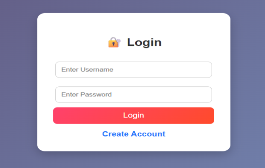
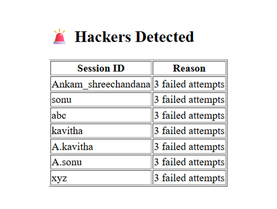
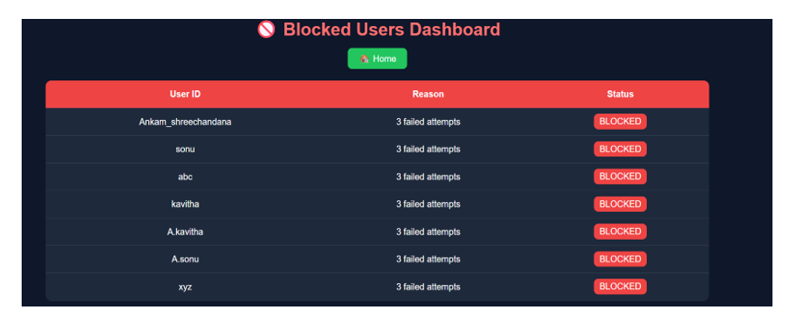

# 🔗 Blockchain-Based Supply Chain Information Sharing Mechanism

### Secure • Transparent • Traceable Supply Chain Management

## 📌 Project Overview

The **Blockchain-Based Supply Chain Information Sharing Mechanism** is a Python-based web application designed to improve security, transparency, data integrity, and traceability in supply chain management using Blockchain technology.

Traditional supply chain systems often face problems such as data manipulation, lack of transparency, inefficient product tracking, and cybersecurity threats.

To overcome these challenges, this project integrates Blockchain technology with an SQLite database to securely record supply chain transactions and maintain reliable information sharing.

The system is developed using Python and Flask. It allows users to register, log in, add supply chain transactions, mine blocks using the Proof of Work algorithm, validate the blockchain, and track products throughout the supply chain.

Additionally, the system includes a cybersecurity module that monitors login activities, detects suspicious users, identifies potential hackers through dataset-based analysis, and displays security information through interactive charts.

## 🎯 Project Objectives

- To develop a secure supply chain information-sharing mechanism using Blockchain technology.
- To maintain transaction integrity using cryptographic hashing.
- To improve transparency among supply chain participants.
- To provide product tracking throughout different supply chain stages.
- To implement secure user registration and authentication.
- To detect suspicious login activities and potential cyber threats.
- To perform dataset-based hacker detection.
- To store and retrieve information efficiently using SQLite.
- To visualize transaction and cybersecurity information through charts.

## 🚀 Key Features

### 1. Blockchain Implementation
- Creation and management of blocks.
- SHA-256 cryptographic hashing.
- Proof of Work (PoW) mining mechanism.
- Linking blocks using previous block hashes.
- Blockchain integrity validation.
- Detection of blockchain tampering.

### 2. Supply Chain Transaction Management
- Add supply chain transactions.
- Record sender, receiver, and product information.
- Store transactions in the database.
- Include pending transactions in newly mined blocks.
- Maintain transaction history.

### 3. Product Tracking
- Search products by name.
- Retrieve product transaction history.
- Track product movement between supply chain participants.
- View product information throughout different stages.

### 4. User Authentication
- User registration.
- Secure login interface.
- Credential verification.
- Login attempt monitoring.
- Session management.
  ###  Login Page

###  Main Dashboard


### 5. Cybersecurity and Hacker Detection
- Monitor unsuccessful login attempts.
- Identify suspicious login activities.
- Detect repeated failed login attempts.
- Identify unusual login times.
- Block suspicious users.
- Maintain a list of detected hackers.
  ###  Hacker Detection


### 6. Dataset-Based Analysis
- Import cybersecurity intrusion datasets.
- Analyze login attempts and failed logins.
- Identify unusual access patterns.
- Detect potential malicious activities using predefined conditions.
- Store detected hacker information in SQLite.
  

### 7. Data Visualization
- Interactive charts using Chart.js.
- Hacker detection statistics.
- Product analytics.
- Transaction flow visualization.
- Dashboard-based monitoring.
  ###  Blocked Users Dashboard


### 8. Database Management
- SQLite database integration.
- User information storage.
- Transaction management.
- Blockchain block storage.
- Login attempt records.
- Hacker information management.
- Dataset storage.

## 🏗️ System Architecture

The system follows a client-server architecture consisting of four major layers.

**1. Presentation Layer (Frontend)**
- HTML
- CSS
- JavaScript
- Chart.js

Provides interfaces for registration, login, transactions, blockchain management, product tracking, and dashboards.

**2. Application Layer (Backend)**
- Python
- Flask

Handles application routing, user authentication, transaction processing, blockchain operations, and hacker detection.

**3. Blockchain Layer**
- Block creation
- Proof of Work
- SHA-256 hashing
- Blockchain validation
- Transaction management

**4. Data Layer**
- SQLite Database

Stores users, transactions, blocks, login attempts, detected hackers, and dataset information.

## 🔄 Working Process

The application follows these major steps:

1. **User Registration:** New users register by providing their credentials.
2. **User Login:** Registered users log in to access the application.
3. **Transaction Addition:** Users enter sender, receiver, and product details.
4. **Transaction Storage:** Transaction information is stored in the blockchain module and SQLite database.
5. **Block Mining:** Pending transactions are grouped into blocks using the Proof of Work algorithm.
6. **Blockchain Validation:** The system verifies block hashes and previous hash connections.
7. **Product Tracking:** Users search for products and retrieve their transaction history.
8. **Hacker Detection:** Suspicious login activities are monitored and identified.
9. **Dataset Analysis:** Cybersecurity data is analyzed to identify potential hackers.
10. **Data Visualization:** Charts display transaction analytics and hacker statistics.

## 🛠️ Technologies Used

| Technology | Purpose |
|---|---|
| Python | Backend programming |
| Flask | Web application framework |
| Blockchain | Secure transaction management |
| SQLite | Database management |
| HTML | Web page structure |
| CSS | User interface styling |
| JavaScript | Frontend interaction |
| Chart.js | Data visualization |
| Pandas | Cybersecurity dataset analysis |
| Hashlib | SHA-256 hash generation |
| JSON | Structured data handling |

## 📂 Project Modules

The project consists of nine major modules:

1. Blockchain Module
2. Transaction Module
3. Block Management Module
4. Authentication Module
5. Hacker Detection Module
6. Dataset Analysis Module
7. Database Module
8. User Interface Module
9. Product Tracking Module

## 📁 Project Structure

```text
Blockchain-Based-Supply-Chain/
│
├── app.py
├── blockchain.py
├── database.py
├── dataset_analysis.py
├── insert_dataset.py
├── cybersecurity_intrusion_data.csv
├── blockchain.db
│
├── routes/
│   ├── transaction_routes.py
│   ├── block_routes.py
│   └── utility_routes.py
│
├── templates/
│   ├── index.html
│   ├── login.html
│   ├── register.html
│   ├── hackers.html
│   └── blocked_dashboard.html
│
├── static/
│   ├── css/
│   ├── js/
│   └── images/
│
├── README.md
└── requirements.txt
```

## ⚙️ Installation and Execution

### Prerequisites

- Python 3.x
- VS Code or PyCharm
- Web browser
- Required Python libraries

### Step 1: Clone the Repository

```bash
git clone YOUR_GITHUB_REPOSITORY_URL
```

### Step 2: Navigate to the Project Folder

```bash
cd Blockchain-Based-Supply-Chain
```

### Step 3: Install Dependencies

```bash
pip install flask pandas
```

### Step 4: Initialize the Database

```bash
python -c "from database import init_db; init_db()"
```

### Step 5: Insert Cybersecurity Dataset

```bash
python insert_dataset.py
```

### Step 6: Run Dataset Analysis

```bash
python dataset_analysis.py
```

### Step 7: Start the Application

```bash
python app.py
```

### Step 8: Open in Browser

```text
http://127.0.0.1:5000/
```

**Note:** The project must include its routes, templates, and static files. The commands above assume the database initialization function is available and the required project files are present.

## 💻 Hardware Requirements

- Processor: Intel Core i3 or higher.
- RAM: 4 GB (8 GB recommended).
- Hard Disk: 500 GB or above.
- System Type: 64-bit operating system.

## 📊 Results

The implemented system demonstrates the integration of Blockchain technology, database management, and cybersecurity mechanisms.

The project provides the following results:

- Successful recording of supply chain transactions.
- Block creation using Proof of Work.
- Blockchain integrity verification.
- Product transaction history tracking.
- User authentication and login monitoring.
- Detection of suspicious login activities.
- Dataset-based hacker identification.
- Visualization of product analytics and hacker statistics.

## 🔮 Future Enhancements

The project can be improved through the following enhancements:

- Integration of Machine Learning algorithms for advanced hacker detection.
- Implementation of a distributed blockchain network.
- Password encryption using bcrypt.
- Migration from SQLite to MySQL or MongoDB.
- Development of a responsive frontend using React or Angular.
- Real-time security notifications.
- Mobile application integration.
- IoT-based product tracking.
- Cloud deployment for improved scalability.

## 🌍 Sustainable Development Goals (SDGs)

This project contributes to the following United Nations Sustainable Development Goals:

**SDG 9 – Industry, Innovation and Infrastructure**

Promotes technological innovation and strengthens digital infrastructure through secure and transparent supply chain information sharing.

**SDG 16 – Peace, Justice and Strong Institutions**

Promotes accountability, data integrity, secure information sharing, and protection against unauthorized access.

## 🎓 Academic Project Information

**Project Title:** Blockchain-Based Supply Chain Information Sharing Mechanism

**Department:** Information Technology

**Institution:** Kakatiya Institute of Technology & Science, Warangal

**Academic Year:** 2025–2026

**Project Supervisor:** Dr. G. Sathish Kumar

## 📝 Conclusion

The Blockchain-Based Supply Chain Information Sharing Mechanism demonstrates how blockchain technology can improve the security, transparency, and traceability of supply chain operations.

By integrating Blockchain, Flask, SQLite, and cybersecurity mechanisms, the system provides transaction management, product tracking, blockchain validation, user authentication, and hacker detection functionalities.

The project offers a practical approach to addressing the limitations of traditional supply chain systems and provides a foundation for future improvements using distributed blockchain networks, machine learning, and cloud technologies.

---


